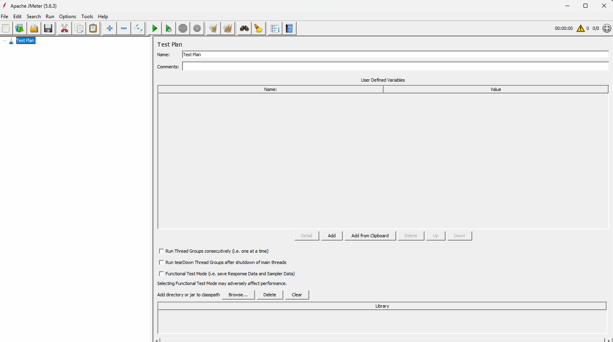
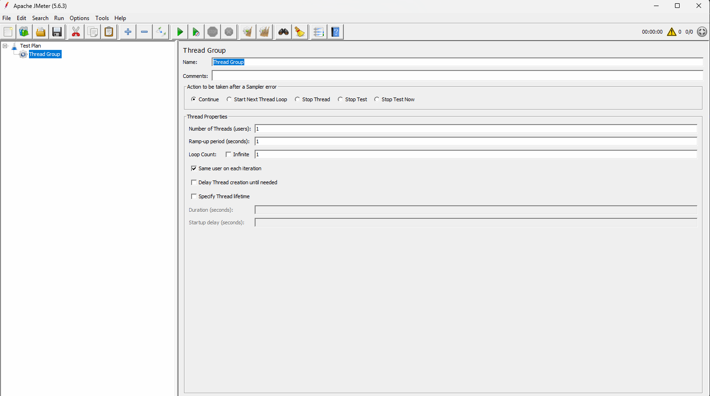

# API performance testing (step by step)

## What is performance testing? 
Performance testing is all about validating our application in such a way that we know what will happen when we are going to deploy multiple users at a time: how exactly our application is responding to each and every user. 

In short, performance testing is all about how fast the application is responding to each and every instruction provided by the user and how stable our application is when multiple users are using our application continuously. 

## Different types of performance testing techniques ?

1. Load testing => Load testing is all about testing the application under expected user load by gradually increasing the load. 

For example, the capacity of our application is 100 users. In this case, we are going to start from 10 users and gradually increase the user count up to 100 by taking some time interval. The main goal is just to verify the response time and stability of our application when we are gradually increasing the load up to the max limit. 

2. Stress testing => Stress testing is a concept of pushing our system beyond the limit to understand the breaking point.

For example, the capacity of our application is 100 users. Now, we are going to add 10% more users gradually. We are going to increase the load beyond the max limit and verify application behavior with this additional load. We will understand what the breaking point is, where exactly the application is not going to respond. 

3. Spike testing => Spike testing is all about validating the application by suddenly increasing or decreasing the load. 

The best example for this Spike testing is flash sales happening on Amazon or Flipkart websites at midnight. 

4. Soak testing or endurance testing => Endurance testing is all about running the application with a particular load for a longer duration continuously. The main goal is to understand the application performance and the degradation of application performance when we are going to maintain the same load for so long. 

## Why is performance testing so important? 
Performance testing is very important because even though your application features are working really great, every time a user is going to log in to your application, if your application's performance is poor ,Most of the users will leave your application shortly. 

## For all the different tools available in the market to do performance testing ?
1. Apache Jmeter 
2. HP Load Runner 
3. BlazeMeter 

## What is JMETER, and how will JMETER work? 
JMETER is a tool that is going to help us to validate the application performance by simulating multiple users virtually. The JMETER tool is an open-source performance testing tool. Mainly, this JMETER tool will be used to validate the performance of our application APIs or web services. 

## How to perform API performance testing using JMeter ? (step by step)

-Pre-requisites :
1. We need to install JDK before running JMeter. (https://download.oracle.com/java/27/latest/jdk-27_windows-x64_bin.exe)

2. Download the JMeter tool. (https://dlcdn.apache.org//jmeter/binaries/apache-jmeter-5.6.3.zip)

### How to launch the JMeter tool? 

- Extract the files from the JMETER zip file. 
- Navigate to the subfolder 'bin'. 
- Double-click on the 'ApacheJmeter.jar' file. 
- Wait until the JMeter UI is launched with the test plan template. 

### What is a test plan in JMETER? 
A test plan in JMETER is a template or a root folder that consists of different files & configurations about what to test, how to test, and with how many users you want to validate your application APIs. 

Within this test plan, we can add 

Thread group (Thread group is a template that consists of the number of threads or users you want to create to test the application API performance and the time interval to deploy. )
Samplers (Request sent by the virtual users to test the application performance )
Listeners (A listener is a component that will help us to monitor and capture the test results. )
Configuration elements (Set of templates we are going to use to maintain environment variables and respective values )
Assertions  (Assertions are the default methods provided by JMETER to validate the output values received from the JMETER tool. )

- Sample TestPlan

### What is a Thread group in JMETER? 
Thread group is a template where we are going to add a couple of details like 
- Total number of virtual users you want to deploy 
- Ramp-up Period (How much time do we want to use to deploy this many users? )
- How many iterations (How many times do we want to repeat the entire process? )

-Sample Thread Group

-Details to be filled in the thread group template 
1. Name : Name of your project or purpose of running the specific request by using the JMeter tool 
For example, for our current project: API performance testing for GitHub application 

2. Comments : Short description about your project and the APIs that you are planning to validate 
For example, as part of this test plan, I'm planning to validate different scenarios related to GitHub repositories and respective API performance validations. 

3. Action to be taken after this sampler error : What should happen when your request is failing in the middle of the execution? 
Continue (default) : Ignore the error and continue the execution for the remaining API request with all the users. 
Start next thread loop. => Stop the current iteration and start the next iteration. 
Stop thread. => Stop the entire thread execution for the current user. 
Stop Test => Stop the entire test execution. 

4. Thread properties (Most important part of the thread group )
- Number of threads (users): How many virtual users do you want to create and deploy? 
Ex: 100 (That means we are planning to create 100 virtual users to test the API performance. )
- Ramp up period (in seconds) : Total time to deploy all the users that we have created 
Ex: 10 (That means 100 users will be deployed in 10 seconds. That means we are going to deploy 10 users per second. ) 
- Loop count : Total number of iterations to be executed to repeat the same process 
Ex: 2 (That means I want to repeat the same 100 users within 10 seconds for 2 times. )

5. Same user on each iteration : That means the same virtual users will be repeated instead of tracing the users in each iteration. 

6. Delay thread creation until needed. : Whenever we are going to create 100 users and you want to deploy in 10 seconds, that means every second we need only 10 users. Instead of creating all 100 users initially, whenever it's needed, I am going to create 10 users and I am going to deploy the same. 

7. Specify thread lifetime. 
 => Duration : Duration is all about the total time that you want to spend to deploy multiple users to test the application, or simply how much time you want to run this entire JMeter test execution process. 
 => Startup delay : Delay before each and every test begins. For example, if I add 2 seconds, that means every time, it is going to wait for 2 seconds, and then only it is going to deploy the user to test the API request. 

## Configuration elements 
Configuration elements are all about a set of templates which we are going to use to maintain the configuration data or common data which we can reuse across the API requests. 

## Samplers in JMETER 
Sampler is all about a set of templates where we are going to update the request details within the JMETER tool. 